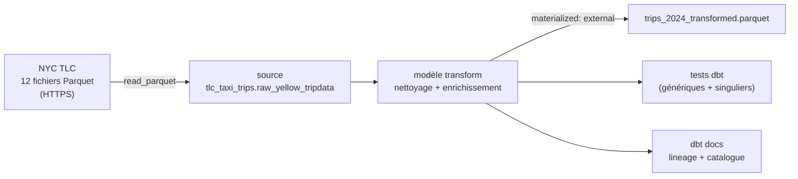

# NYC Taxi Trips 2024 — Pipeline de données avec dbt & DuckDB

Pipeline ELT qui ingère **41 millions de courses** de taxis jaunes new-yorkais (année 2024, données publiques NYC TLC), les nettoie, les enrichit et les teste avec **dbt**, sur un moteur analytique local **DuckDB** — sans serveur ni cloud.

| | |
|---|---|
| **Volume brut** | 41 169 720 courses (12 fichiers Parquet mensuels) |
| **Volume après nettoyage** | 34 891 601 courses (84,7 % conservées) |
| **Sortie** | `output/trips_2024_transformed.parquet` (~740 Mo) |
| **Contrôles qualité** | 20 tests génériques + 4 tests singuliers |
| **Stack** | dbt-core 1.12 · dbt-duckdb 1.11 · DuckDB 1.5 · dbt_expectations · Python 3.13 |

---

## Architecture



**Pourquoi ce choix ?**
- **DuckDB lit les Parquet directement par HTTPS** : pas d'étape de téléchargement ni de chargement préalable, la source *est* l'URL.
- **dbt** apporte ce qu'un simple script SQL n'a pas : dépendances entre objets (`source`, `ref`), tests déclaratifs, documentation et lineage générés automatiquement.
- **Matérialisation `external`** (spécifique à dbt-duckdb) : le résultat est écrit en Parquet, un format colonne compressé, lisible par n'importe quel outil (Pandas, Spark, Power BI…).

---

## Source de données

[NYC Taxi & Limousine Commission — Trip Record Data](https://www.nyc.gov/site/tlc/about/tlc-trip-record-data.page), fichiers *Yellow Taxi* de janvier à décembre 2024.

La source est déclarée une seule fois dans [`sources.yml`](formation_dbt/models/taxi_trips/sources.yml). Plutôt que de lister 12 URLs, elles sont **générées dynamiquement** :

```sql
read_parquet(
  list_transform(
    range(1, 13),
    m -> 'https://d37ci6vzurychx.cloudfront.net/trip-data/yellow_tripdata_2024-'
         || lpad(m::text, 2, '0') || '.parquet'
  )
)
```

Passer à une autre année ou à un autre périmètre ne demande de modifier qu'une ligne.

---

## Exploration préalable

Avant d'écrire la moindre transformation, j'ai profilé les données brutes ([`analyse_exploratoire.sql`](formation_dbt/analyses/analyse_exploratoire.sql)) pour identifier les anomalies :

- distribution des codes `VendorID`, `RatecodeID`, `payment_type`, `store_and_fwd_flag` ;
- courses dont la **dépose précède la prise en charge** ;
- **distances nulles ou négatives** ;
- **montants nuls ou négatifs** (remboursements, annulations) ;
- dates hors de l'année 2024 (horodatages erronés dans les données source).

Chaque règle de nettoyage ci-dessous répond à une anomalie constatée.

---

## Transformation — [`transform.sql`](formation_dbt/models/taxi_trips/transform.sql)

Le modèle est découpé en CTE successives, chacune avec une responsabilité unique :

| Étape | Rôle |
|---|---|
| `source_data` | Lecture de la source, suppression des colonnes inutiles (`VendorID`, `RatecodeID`) |
| `filtered_data` | Règles de qualité métier (voir ci-dessous) |
| `transformed_data` | Typage et colonnes dérivées |
| `final_data` | Restriction stricte à l'année 2024 |

**Règles de filtrage**

| Règle | Justification |
|---|---|
| `passenger_count > 0` | Course sans passager = saisie invalide |
| `trip_distance > 0` | Distance nulle ou négative = erreur de compteur |
| `total_amount > 0` | Exclut remboursements et annulations |
| `pickup < dropoff` | Incohérence temporelle |
| `store_and_fwd_flag = 'N'` | Ne garde que les courses transmises en temps réel |
| `tip_amount >= 0` | Pourboire négatif impossible |
| `payment_type IN (1, 2)` | Carte et espèces uniquement (exclut litiges, gratuités, inconnus) |
| pickup et dropoff en 2024 | Supprime les horodatages aberrants |
| `trip_duration_minutes > 0` | Durée nulle après arrondi à la minute |

**Enrichissements**

- `payment_method` : code numérique traduit en libellé lisible (`Credit card` / `cash`) ;
- `trip_duration_minutes` : durée calculée avec `DATE_DIFF` ;
- `passenger_count` : converti en `BIGINT` pour un typage homogène.

---

## Qualité des données

### Tests génériques — [`schema.yml`](formation_dbt/models/taxi_trips/schema.yml)

Déclarés en YAML, avec les tests natifs dbt et le package **[dbt_expectations](https://github.com/metaplane/dbt-expectations)** :

| Colonne | Tests |
|---|---|
| `passenger_count` | non nul, ≥ 1, type `BIGINT` |
| `payment_method` | non nul, valeurs acceptées `Credit card` / `cash` |
| `trip_duration_minutes` | non nul, > 0 |
| `tpep_pickup_datetime`, `tpep_dropoff_datetime` | non nuls, type `TIMESTAMP` |
| `trip_distance`, `total_amount` | non nuls, > 0 |
| `tip_amount` | ≥ 0 |
| `store_and_fwd_flag` | valeur acceptée `N` |
| `PULocationID`, `DOLocationID` | non nuls |
| *niveau modèle* | dépose strictement postérieure à la prise en charge |

### Tests singuliers — [`tests/`](formation_dbt/tests/)

Requêtes SQL sur mesure : le test échoue si la requête renvoie au moins une ligne.

- `test_distinct_months` — vérifie que **les 12 mois** sont présents, en prise en charge comme en dépose (détecte un fichier mensuel manquant ou un filtre trop agressif) ;
- `test_passenger_count`, `test_trip_distance`, `test_trip_duration` — contrôles de cohérence sur les valeurs.

---

## Résultats

Sur les 34,9 millions de courses retenues :

| Indicateur | Valeur |
|---|---|
| Taux de conservation | 84,7 % (6,3 M de lignes écartées) |
| Durée moyenne d'une course | 17,7 min |
| Montant moyen | 29,01 $ |
| Paiement par carte | 85,2 % |
| Paiement en espèces | 14,8 % |

---

## Lancer le projet

**Prérequis** : Python 3.10+

```powershell
# 1. Environnement
python -m venv .venv
.venv\Scripts\activate            # Linux/macOS : source .venv/bin/activate
pip install dbt-duckdb

# 2. Dépendances dbt (dbt_expectations)
cd formation_dbt
dbt deps

# 3. Construire le modèle puis lancer tous les tests
dbt build

# 4. Documentation et lineage
dbt docs generate
dbt docs serve                    # http://localhost:8080
```

Le résultat est lisible directement avec DuckDB :

```sql
SELECT payment_method, COUNT(*), AVG(total_amount)
FROM 'output/trips_2024_transformed.parquet'
GROUP BY 1;
```

> ⚠️ DuckDB n'autorise qu'un seul processus en écriture : fermer le CLI `duckdb` avant de lancer `dbt run` / `dbt build`.

---

## Structure du projet

```
formation_dbt/
├── models/taxi_trips/
│   ├── sources.yml          # Déclaration de la source (12 Parquet distants)
│   ├── transform.sql        # Modèle de nettoyage / enrichissement
│   └── schema.yml           # Documentation des colonnes + tests génériques
├── tests/                   # Tests singuliers SQL
├── analyses/
│   └── analyse_exploratoire.sql   # Profilage des données brutes
├── output/                  # Base DuckDB + Parquet produit (non versionnés)
├── dbt_project.yml          # Configuration du projet
├── packages.yml             # dbt_expectations
└── profiles.yml             # Connexion DuckDB locale
```

---

## Ce que j'ai appris

- **Jinja s'exécute avant le SQL** : un `{{ source() }}` placé dans un commentaire `--` est quand même rendu ; si la source tient sur plusieurs lignes, le commentaire « casse ». Il faut utiliser `{# ... #}`.
- **Verrouillage DuckDB** : un fichier `.db` n'accepte qu'un seul écrivain ; le CLI ouvert bloque dbt.
- **Vue vs table vs external** : une vue sur des Parquet distants relit Internet à chaque requête (et à chaque test) ; matérialiser le résultat change radicalement les temps d'exécution.
- **Évolution de dbt 1.10+** : `data_tests:` remplace `tests:`, les paramètres de tests passent sous `arguments:` et `meta` sous `config:`.

---

## Pistes d'amélioration

- **Architecture en couches** `staging → intermediate → marts` : isoler le nettoyage, puis construire des tables d'agrégats (revenus par zone, par heure, par jour).
- **Jointure avec la table des zones TLC** (fichier `taxi_zone_lookup.csv` en *seed*) pour obtenir les noms de quartiers à partir de `PULocationID` / `DOLocationID`.
- **Modèle incrémental** : ne traiter que le nouveau mois à chaque exécution.
- **Macros** pour factoriser les règles de filtrage réutilisables.
- **CI GitHub Actions** : `dbt build` à chaque push et publication de la documentation sur GitHub Pages.
